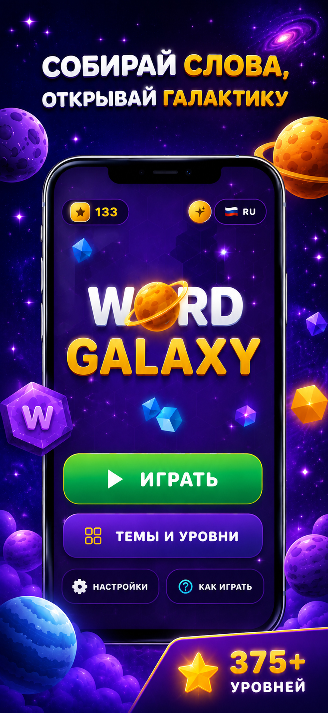
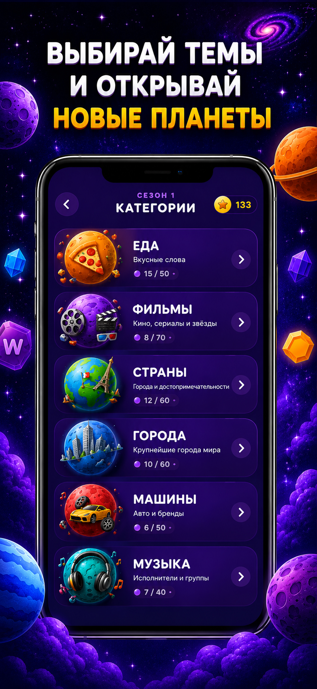
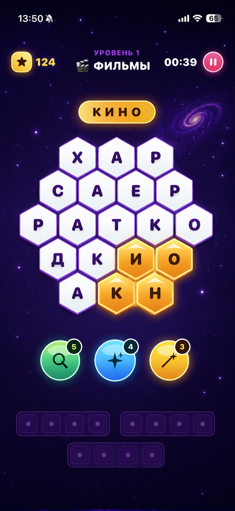
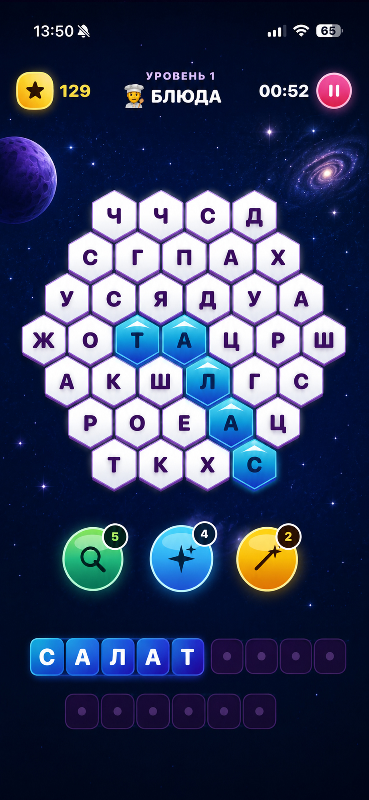

# Собирайте слова, открывайте новые миры и исследуйте галактику! Word Galaxy — увлекательная головоломка для любителей слов, где каждый уровень — новое испытание.

---
Word Galaxy: Wordle Puzzle

Собирайте слова, открывайте новые темы и отправляйтесь в увлекательное путешествие по галактике.

Word Galaxy: Wordle Puzzle — красочная словесная головоломка, в которой классическая механика поиска слов сочетается с космической атмосферой, красивой анимацией и множеством интересных испытаний.

Собирайте слова и открывайте галактику

Ищите и составляйте слова из букв, находите правильные комбинации и проходите уровни. Каждое найденное слово приближает вас к завершению уровня и открытию новых испытаний.

Исследуйте множество тематических категорий:Страны, Еда, Фильмы, Города, Машины, Музыка, и другие интересные темы
Каждая категория предлагает собственный набор слов и уровней, поэтому игровой процесс постоянно меняется.

Сотни уровней
Проходите уровни, открывайте новые категории и проверяйте свой словарный запас. По мере продвижения задания становятся интереснее и требуют всё больше внимания и сообразительности.

Бонусы и помощь
Застряли на сложном слове? Используйте специальные бонусы, которые помогут найти решение и продолжить прохождение.

Получайте награды за прохождение уровней и используйте их для получения дополнительной помощи.

Word Galaxy поддерживает несколько языков. Выбирайте удобный язык и играйте так, как вам комфортнее. Переключение языка доступно непосредственно в настройках игры.

Плавные анимации, эффекты свечения, динамические изменения букв и визуальные эффекты при правильных ответах делают прохождение уровней более живым и увлекательным.

Музыка и звуковые эффекты
Погрузитесь в атмосферу игры благодаря приятной музыке и звуковым эффектам. Музыка, анимация и визуальные эффекты создают единое игровое пространство, в котором приятно проводить время.

Простая механика — увлекательный процесс
Правила легко освоить, но найти все слова бывает непросто. Игра подходит как для короткой игровой сессии, так и для долгого прохождения уровней.

Собирайте слова. Открывайте новые темы. Исследуйте галактику.

Word Galaxy: Wordle Puzzle — ваша словесная вселенная начинается здесь.

  

🌍 Мультиязычная поддержка
Полная локализация на 6 языках:

Английский 🇺🇸
Русский 🇷🇺
Белорусский 🇧🇾
Украинский 🇺🇦
Немецкий 🇩🇪
Польский 
 

Следите за нашими новостями!
Хотите быть в курсе обновлений, Подписывайтесь на наш канал на YouTube: https://www.youtube.com/evilgen21 и https://www.youtube.com/c/MacWinX/videos Мы регулярно публикуем полезные советы, обзоры и многое другое!

Обратная связь
Мы всегда рады услышать ваше мнение! Если у вас возникли вопросы, предложения или проблемы с игрой, напишите нам на почту: yauheni.sabina.dev@icloud.com. Мы постараемся помочь вам в кратчайшие сроки!


Скачать Word Galaxy: Worlde Puzzle сейчас <a href="https://apps.apple.com/app/id6784642804">Word Galaxy: Worlde Puzzle</a>
